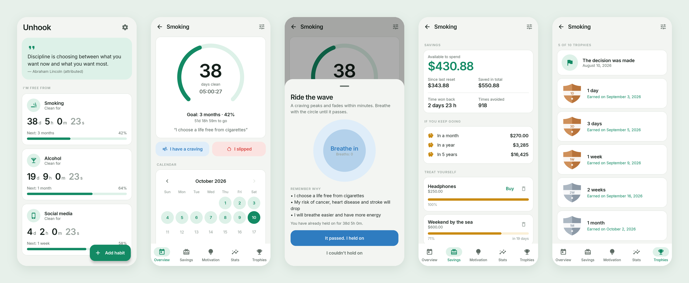

<div align="center">


# Unhook

### Quit a habit, one day at a time

*Count the days, the money and the hours you win back. Free, no ads, no premium, no account.*

[](https://github.com/bigdevwhale/unhook/actions/workflows/android.yml)
[](https://github.com/bigdevwhale/unhook/releases/latest)


[](LICENSE)

**English** · [Русский](README.ru.md) · [Website](https://bigdevwhale.github.io/stillcraft/apps/unhook/)



</div>

---

## The idea

Quitting is not one big decision. It is the same small decision, made again every day, often at the worst possible moment.

Unhook keeps that decision in sight. It counts every clean minute, turns them into money saved and time won back, celebrates each milestone, and gives you something to do when the urge hits. A slip does not wipe out your progress: the counter restarts, your best streak and history stay.

Quit trackers usually keep the good parts behind a subscription and show ads to people who are trying to break a habit. Unhook has everything unlocked, for free, and works fully offline.

## What it does

| | Feature | How it works |
|---|---|---|
| ⏱️ | **Live counter** | Days, hours, minutes and seconds since the last time, on the home screen and in a ring that fills toward the next goal. Track as many habits as you like. |
| 🎯 | **Goals that climb on their own** | 1 day → 3 days → 1 week → 2 weeks → 1 month → 3 → 6 months → 1 → 2 → 5 years. No goal to pick: the next rung is always the current one. |
| 🌊 | **SOS for cravings** | *I have a craving* opens paced breathing (in 4 · hold 4 · out 6) next to your own reasons. When the wave passes, one tap logs the win. |
| 💰 | **Savings & rewards** | Money not spent, time won back, times avoided, plus a projection for a month, a year and five years. Add things you want to buy; when the savings cover one, buy it and it comes off the balance. |
| 💡 | **Motivation** | Your reasons to quit, a recovery timeline (smoking, alcohol, sugar, or a general one) that ticks off as time passes, and a quote of the day. |
| 📊 | **Statistics** | Quit date, best, average, shortest and longest streaks, resets, cravings beaten, a chart of all your streaks. |
| 🏆 | **Trophies** | Ten shields from bronze to emerald, each with the date you earned it or when you will. |
| 📅 | **Calendar & diary** | Clean days in green, slips in red. Notes with a mood, cravings beaten and slips with what triggered them, in one timeline. A mistaken slip can be undone. |
| 🔔 | **Milestone notifications** | A short note when you reach a new trophy, and a home‑screen widget with clean days for up to three habits. |

16 ready-made habits (smoking, vaping, alcohol, porn, sugar, gambling, procrastination, social media, games, fast food, coffee, energy drinks, cannabis, impulse shopping, nail biting) or your own, with an icon of your choice.

## English & Русский

Every screen, suggested reason, recovery step and quote is translated, with proper Russian plurals. Switch in **Settings → Language** (System / English / Русский); on Android 13+ the app also shows up in the system's per‑app language settings. Stock habit names and reasons follow the language you switch to.

Light and dark themes, following the system or set by hand.

## Download

Get the APK from **[Releases](https://github.com/bigdevwhale/unhook/releases/latest)**, or the debug APK attached to any [CI run](https://github.com/bigdevwhale/unhook/actions/workflows/android.yml).
Android 8.0 (API 26) or newer.

> [!TIP]
> On Xiaomi (MIUI / HyperOS), Huawei and some other phones the system kills background apps and drops their alarms.
> If trophy notifications arrive late, allow **Autostart** for Unhook and set battery usage to **No restrictions**. *Settings → Notifications arrive late?* opens the right screen.

## Privacy

No accounts, no servers, no analytics, no ads. Habits, diary and history live in a local database on the phone.
**Settings → Backup** exports everything to a JSON file you keep, and restores it on a new phone.
Permissions: notifications, and starting after reboot to re‑arm the milestone alarm.

## Under the hood

- **Kotlin + Jetpack Compose**, Material 3 with a custom palette (light and dark), the Inter typeface and icons from Material Symbols.
- **Room** for habits, slips, reasons, rewards and diary · **DataStore** for settings.
- **AlarmManager** (`setAndAllowWhileIdle`, no exact‑alarm permission): one alarm at the soonest upcoming trophy across all habits, re‑armed on boot, time changes and every app start.
- The rules (goal ladder, savings, streak statistics, calendar marks) live in pure Kotlin in `domain/Progress.kt`, covered by unit tests.
- Per‑app language via `AppCompatDelegate.setApplicationLocales` with an auto‑generated locale config.

```
app/src/main/java/app/unhook/
├── domain/      milestones, goals, savings, streak stats, calendar (pure Kotlin, unit-tested)
├── data/        Room database, DataStore settings, JSON backup
├── notify/      milestone alarm, notification, boot receiver
├── widget/      home-screen counter
└── ui/          theme, components, onboarding · home · habit (5 tabs) · edit · settings
```

## Build from source

Requirements: JDK 17+ (Android Studio's bundled JBR works) and the Android SDK.

```bash
git clone https://github.com/bigdevwhale/unhook.git
cd unhook
./gradlew testDebugUnitTest      # unit tests
./gradlew assembleDebug          # app/build/outputs/apk/debug/app-debug.apk
./gradlew installDebug           # install on a connected device
./gradlew installDebug -Pdemo    # app.unhook.demo with made-up habits, next to the real app
```

### CI / releases

- **Android CI** (`.github/workflows/android.yml`): on every push and PR runs unit tests and lint (missing translations fail the build) and uploads a debug APK.
- **Release** (`.github/workflows/release.yml`): push a tag like `v1.0.0` (or run it manually) to build a signed release APK and publish it as a GitHub Release.

## License

[MIT](LICENSE) · Inter typeface under the SIL Open Font License 1.1 · Material Symbols under the Apache License 2.0.

Health timelines are general information, not medical advice.
