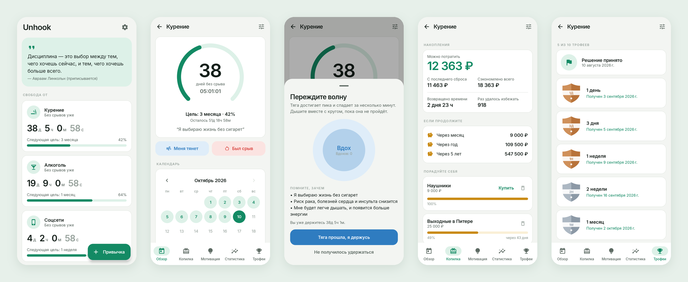

<div align="center">


# Unhook

### Бросайте привычку день за днём

*Считайте дни, деньги и часы, которые вы возвращаете. Бесплатно, без рекламы, без премиума и аккаунта.*

[](https://github.com/bigdevwhale/unhook/actions/workflows/android.yml)
[](https://github.com/bigdevwhale/unhook/releases/latest)


[](LICENSE)

[English](README.md) · **Русский** · [Сайт](https://bigdevwhale.github.io/stillcraft/apps/unhook/)



</div>

---

## Идея

Бросить — это не одно большое решение. Это одно и то же маленькое решение, которое приходится принимать каждый день, и часто в самый неподходящий момент.

Unhook держит это решение перед глазами. Он считает каждую минуту без срыва, превращает их в сэкономленные деньги и возвращённое время, отмечает каждую веху и подсказывает, что делать, когда накатывает тяга. Срыв не обнуляет прогресс: счётчик начинается заново, а лучшая серия и история остаются.

Обычно такие трекеры прячут лучшее за подпиской и показывают рекламу людям, которые пытаются избавиться от зависимости. В Unhook всё открыто, бесплатно и работает без интернета.

## Что умеет

| | Функция | Как работает |
|---|---|---|
| ⏱️ | **Живой счётчик** | Дни, часы, минуты и секунды с последнего раза — на главном экране и в кольце, которое заполняется к следующей цели. Привычек сколько угодно. |
| 🎯 | **Цели растут сами** | 1 день → 3 дня → 1 неделя → 2 недели → 1 месяц → 3 → 6 месяцев → 1 → 2 → 5 лет. Выбирать цель не нужно: текущая — всегда следующая ступень. |
| 🌊 | **SOS при тяге** | Кнопка *«Меня тянет»* открывает дыхание в ритме (вдох 4 · задержка 4 · выдох 6) рядом с вашими причинами. Когда волна прошла, одно касание записывает победу. |
| 💰 | **Копилка и награды** | Сэкономленные деньги, возвращённое время, сколько раз удалось избежать, и прогноз на месяц, год и пять лет. Добавьте то, что хотите купить: когда накоплений хватает — покупайте, сумма спишется из копилки. |
| 💡 | **Мотивация** | Ваши причины бросить, шкала восстановления (курение, алкоголь, сахар или общая), которая отмечается со временем, и цитата дня. |
| 📊 | **Статистика** | День отказа, лучшая, средняя, самая короткая и самая длинная серии, число сбросов, побеждённая тяга, график всех серий. |
| 🏆 | **Трофеи** | Десять щитов от бронзы до изумруда, у каждого — дата получения или когда он будет получен. |
| 📅 | **Календарь и дневник** | Чистые дни зелёные, срывы красные. Заметки с настроением, побеждённая тяга и срывы с причиной — в одной ленте. Случайный срыв можно отменить. |
| 🔔 | **Уведомления о вехах** | Короткое сообщение при новом трофее и виджет на рабочий стол с чистыми днями для трёх привычек. |

16 готовых привычек (курение, вейп, алкоголь, порно, сахар, азартные игры, прокрастинация, соцсети, видеоигры, фастфуд, кофе, энергетики, марихуана, импульсивные покупки, грызть ногти) или своя — с выбором иконки.

## English и Русский

Все экраны, готовые причины, шаги восстановления и цитаты переведены, с правильными русскими падежами и числами. Переключение в **Настройки → Язык** (Как в системе / English / Русский); на Android 13+ приложение есть и в системных настройках языка приложений. Названия готовых привычек и причины переключаются вместе с языком.

Светлая и тёмная темы — как в системе или вручную.

## Скачать

APK — в **[Releases](https://github.com/bigdevwhale/unhook/releases/latest)**, или debug‑APK из любого [запуска CI](https://github.com/bigdevwhale/unhook/actions/workflows/android.yml).
Android 8.0 (API 26) и новее.

> [!TIP]
> На Xiaomi (MIUI / HyperOS), Huawei и некоторых других телефонах система убивает фоновые приложения и сбрасывает их будильники.
> Если уведомления о трофеях приходят с опозданием, разрешите Unhook **Автозапуск** и снимите **ограничения батареи**. *Настройки → Уведомления опаздывают?* открывает нужный экран.

## Приватность

Ни аккаунтов, ни серверов, ни аналитики, ни рекламы. Привычки, дневник и история хранятся в локальной базе на телефоне.
**Настройки → Резервная копия** сохраняет всё в JSON‑файл и восстанавливает на новом телефоне.
Разрешения: уведомления и запуск после перезагрузки, чтобы снова завести будильник вех.

## Как устроено

- **Kotlin + Jetpack Compose**, Material 3 со своей палитрой (светлая и тёмная), шрифт Inter и иконки Material Symbols.
- **Room** для привычек, срывов, причин, наград и дневника · **DataStore** для настроек.
- **AlarmManager** (`setAndAllowWhileIdle`, без разрешения на точные будильники): один будильник на ближайший трофей среди всех привычек, перезаводится после перезагрузки, смены времени и при каждом запуске.
- Правила (лестница целей, накопления, статистика серий, отметки календаря) — чистый Kotlin в `domain/Progress.kt`, покрытый юнит‑тестами.
- Язык приложения через `AppCompatDelegate.setApplicationLocales` с автогенерируемым locale config.

```
app/src/main/java/app/unhook/
├── domain/      вехи, цели, накопления, статистика, календарь (чистый Kotlin, тесты)
├── data/        база Room, настройки DataStore, JSON-копия
├── notify/      будильник вех, уведомление, запуск после перезагрузки
├── widget/      счётчик на рабочем столе
└── ui/          тема, компоненты, онбординг · главная · привычка (5 вкладок) · настройки
```

## Сборка из исходников

Нужны JDK 17+ (подойдёт JBR из Android Studio) и Android SDK.

```bash
git clone https://github.com/bigdevwhale/unhook.git
cd unhook
./gradlew testDebugUnitTest      # юнит-тесты
./gradlew assembleDebug          # app/build/outputs/apk/debug/app-debug.apk
./gradlew installDebug           # установить на подключённый телефон
./gradlew installDebug -Pdemo    # app.unhook.demo с вымышленными привычками, рядом с настоящим
```

### CI / релизы

- **Android CI** (`.github/workflows/android.yml`): на каждый push и PR запускает юнит‑тесты и lint (непереведённые строки ломают сборку) и выкладывает debug‑APK.
- **Release** (`.github/workflows/release.yml`): тег вида `v1.0.0` (или ручной запуск) собирает подписанный release‑APK и публикует GitHub Release.

## Лицензия

[MIT](LICENSE) · шрифт Inter — SIL Open Font License 1.1 · Material Symbols — Apache License 2.0.

Шкалы восстановления — общая информация, а не медицинская рекомендация.
